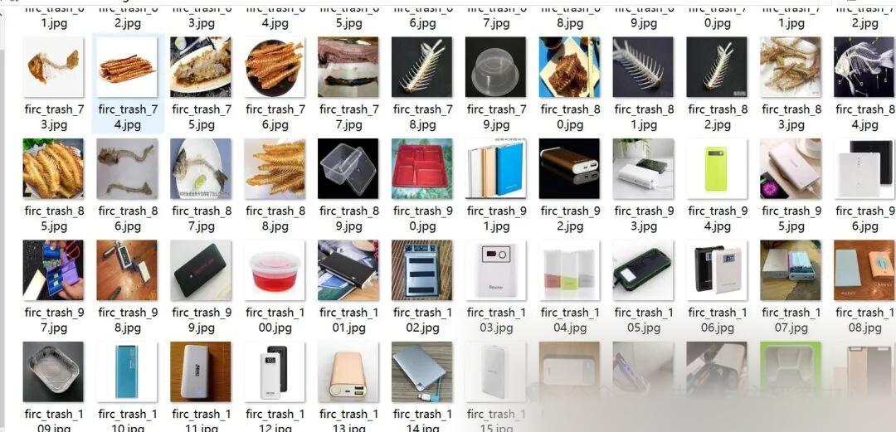
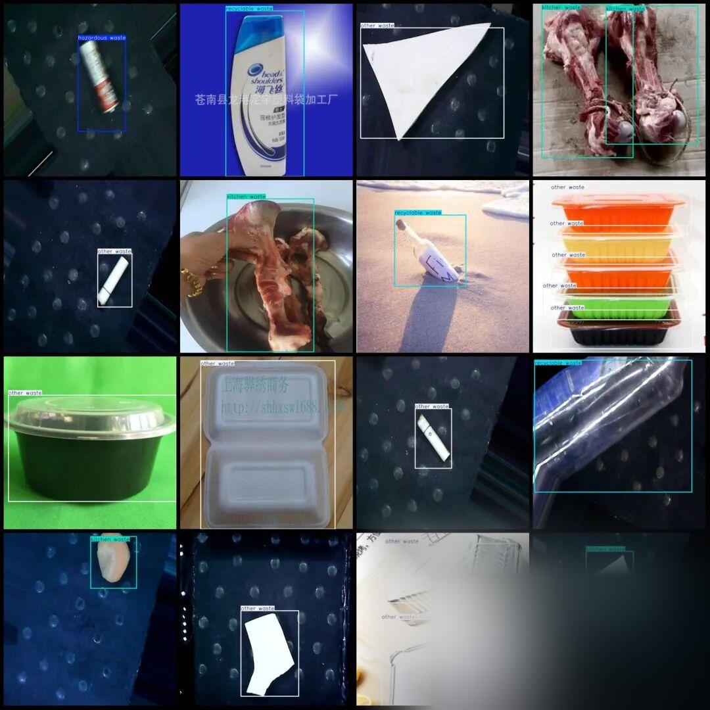

# Dataset for Waste, Recyclable, Hazardous Waste and Detection in VOC+YOLO format with 2739 images in 4 categories

Dataset format: Pascal VOC format + YOLO format (txt file without split path, only containing jpg images and corresponding VOC format xml files and yolo format txt files)

Number of images (number of jpg files): 2739

Number of annotations (number of xml files): 2739

Number of annotations (number of txt files): 2739

Labeling category count: 4

Label category names (note that the order of yolo format categories does not correspond to this, but is based on the labels folder's classes.txt): ["hazardous waste", "kitchen waste", "other waste", "recyclable waste"]

Number of boxes labeled in each category:

Hazardous waste frame count = 797

Kitchen waste frame count = 834

Other waste frame count = 682

Recyclable waste frame count = 1606

Total frame count: 3919

Using labelImg:

Annotation rules: Draw a rectangle around the category.

Important Notice: No

Special : This dataset does not guarantee the accuracy or precision of the trained models or weight files. The dataset is provided with accurate and reasonable annotations only.

Image Preview:

Annotation example:

## Payment

Here is a pay link on Stripe ( https://buy.stripe.com/3cs8yP7sY87d0vu9AB ). Please contact me lonlonago@foxmail.com after funding $89, and I will send you a complete data files , thank you!

